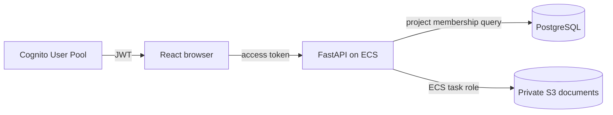

# 5. Architecture A: React + Cognito + FastAPI + PostgreSQL

Consider a subscription-based AI literature screening platform with users, organizations, projects, screening results, and file attachments. Users authenticate with Cognito. Project data lives in PostgreSQL. The API runs on ECS and accesses private S3 objects.



The browser does not receive IAM credentials in this design.

## Request walkthrough: `GET /projects/42/documents`

1. React signs the user in through Cognito User Pool (authorization code + PKCE).
2. React calls FastAPI with `Authorization: Bearer ACCESS_TOKEN`.
3. FastAPI verifies JWT cryptography and required claims.
4. FastAPI checks whether the token's `sub` belongs to Project 42 and may view its documents.
5. FastAPI reads metadata from PostgreSQL and, if needed, retrieves S3 data using the ECS task role.
6. IAM decides whether that task role may read the object. The API returns only authorized content.

| Component | Responsibility |
| --- | --- |
| Cognito User Pool | User credentials, MFA, OIDC/JWT issuance |
| FastAPI JWT middleware | Validates bearer token and coarse scopes |
| FastAPI project check/database | Project access, tenant isolation, owner/editor/viewer roles |
| ECS task role + IAM | Whether the backend can access the specified S3 bucket/object |
| PostgreSQL | Stores project memberships, data, and permissions; does not automatically parse JWTs |

## Minimal FastAPI token validation pattern

This illustrates the verification boundary using PyJWT. Production code also needs resilient JWKS caching/timeouts, structured errors, monitoring, rate limiting, and an explicit key rotation strategy.

```python
# pip install fastapi "PyJWT[crypto]"
from fastapi import Depends, FastAPI, HTTPException
from fastapi.security import HTTPBearer
import jwt

app = FastAPI()
bearer = HTTPBearer(auto_error=True)
REGION = "eu-west-2"
POOL_ID = "eu-west-2_EXAMPLE"
CLIENT_ID = "example_app_client_id"
ISSUER = f"https://cognito-idp.{REGION}.amazonaws.com/{POOL_ID}"
JWKS_URL = f"{ISSUER}/.well-known/jwks.json"
JWKS = jwt.PyJWKClient(JWKS_URL)

def current_user(credentials=Depends(bearer)):
    try:
        token = credentials.credentials
        key = JWKS.get_signing_key_from_jwt(token).key
        claims = jwt.decode(
            token, key, algorithms=["RS256"], issuer=ISSUER,
            options={"verify_aud": False}
        )
        if claims.get("token_use") != "access":
            raise ValueError("Not an access token")
        if claims.get("client_id") != CLIENT_ID:
            raise ValueError("Wrong app client")
        return claims
    except (jwt.PyJWTError, ValueError):
        raise HTTPException(status_code=401, detail="Invalid token")

@app.get("/me")
def me(user=Depends(current_user)):
    return {"sub": user["sub"]}
```

Verify required access-token scopes for each endpoint. Do not accept arbitrary algorithms or keys from a token. If multiple app clients are valid, use an explicit allow-list. Cognito access tokens generally use `client_id`; ID tokens use `aud`.

## Project authorization is a separate check

```python
from fastapi import HTTPException

# Pseudocode: scope the database lookup by both project and user.
def require_project_role(db, project_id: str, user_sub: str,
                         allowed_roles: set[str]):
    membership = db.find_membership(project_id, user_sub)
    if membership is None or membership.role not in allowed_roles:
        raise HTTPException(status_code=403, detail="Forbidden")
    return membership

# GET project -> viewer, editor, owner
# DELETE project -> owner only
# POST document -> editor, owner
```

The browser is not making AWS API requests here. It speaks only to FastAPI; FastAPI uses its task role. An Identity Pool would add credentials and policy complexity without solving project authorization.

