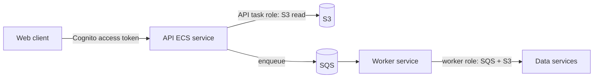

# 7. Architecture C: AWS workloads and microservices

In a multi-service ECS deployment, use different least-privilege task roles for different containers/services when practical, even when all users authenticate against one Cognito User Pool.

| Component | IAM grants | Do not grant |
| --- | --- | --- |
| API ECS task role | Read/write authorized upload prefix; enqueue task | `AdministratorAccess`; unrelated buckets |
| Background worker task role | Consume specific SQS queue; read files; write results | Public sign-in functions; all S3 buckets |
| Task execution role | Pull specific ECR images; emit logs; retrieve configured secrets | Business-data S3 permissions unless operationally required |
| Human CI/CD deployment role | Deploy ECS, update task definitions, constrained `iam:PassRole` | Permanent admin credentials in GitHub secrets |

IAM does not know a task processed “Project 42” just because FastAPI authenticated its caller. Unless trusted tenant context or isolated roles/resources are implemented, one backend role may have AWS access across tenants. Enforce tenant separation in the API, data layer, and object-key design.

## Machine-to-machine calls

For an internal service calling your private application API, use an appropriate service-to-service identity model. Cognito User Pools can support OAuth client-credentials for M2M APIs. When an AWS workload calls an AWS service, use its task/compute role and SigV4. OAuth access tokens and STS credentials serve different endpoints.

