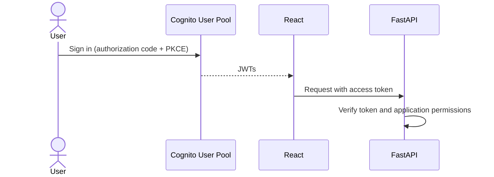

# 2. Cognito User Pools and Identity Pools

## User Pools: application login

A User Pool is a managed user directory and an OAuth 2.0 / OpenID Connect identity provider. It can manage local users; federate Google, Microsoft, SAML, and OIDC identities; issue JWTs; and apply MFA, account lifecycle, and app-client configuration.

### The three important tokens

| Token | Purpose | Important caution |
| --- | --- | --- |
| ID token | Identity claims for the client, such as `sub`, email, and groups | Not a universal API permission grant. |
| Access token | Access to protected APIs and OAuth scopes | Validate signature, issuer, time, `token_use=access`, and client. |
| Refresh token | Obtains fresh tokens subject to session rules | Handle securely; never send as an API bearer token. |

A User Pool app client identifies the application, not a human. For public browser/mobile clients, use a public client without a client secret and prefer authorization code flow with PKCE. A confidential backend client can hold its secret server-side.

### Scopes, groups, and database roles

- **OAuth scopes** express broad API permissions, such as `screening/read`; they are not normally per-project entitlements.
- **User Pool groups** label users (for example, `reviewer` or `admin`) and may appear in token claims. A group does not automatically grant S3 rights or database-row access.
- **Database membership** usually decides resource-level access: Alice may edit Project A but only view Project B. The backend checks the requested project and action.

> Never let a user read every project just because they signed in or carry a broad role such as `reviewer`.

## Identity Pools: bridge to AWS credentials

An Identity Pool is different from a User Pool. It can accept a User Pool token or other supported identity evidence, select a role, and obtain temporary AWS credentials (commonly through AWS STS). Those credentials sign AWS API requests, which IAM evaluates.

Use an Identity Pool when a mobile/web client must call selected AWS services directly under tightly scoped per-user AWS credentials. It is not needed when the browser only calls FastAPI and the backend uses its ECS task role. File upload alone does not require an Identity Pool: the backend can authorize the user and issue a short-lived S3 presigned URL.

### JWTs are not AWS credentials

| User Pool JWT | Temporary AWS credentials |
| --- | --- |
| Usually a bearer token sent to APIs | Access key ID, secret access key, and session token |
| Signed by Cognito (JWK/JWKS) | Used to sign AWS requests with SigV4 |
| Carries identity/claim context | Represents an IAM role session |
| Can be exchanged through an Identity Pool | Checked by IAM on AWS service requests |

The `sub` in a User Pool token identifies a user in that User Pool. The policy variable `${cognito-identity.amazonaws.com:sub}` identifies an Identity Pool identity. They are not interchangeable.

