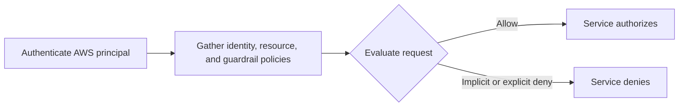

# 3. IAM foundations, roles, and evaluation

IAM policies answer four questions: **who** (principal), **can do what** (action), **to what** (resource ARN), and **under which conditions** (condition). Access is denied by default unless an applicable allow exists; an explicit deny overrides an allow.

## A permissions policy

Attach this identity-based policy to a role to allow reading objects under one prefix:

```json
{
  "Version": "2012-10-17",
  "Statement": [{
    "Sid": "ReadReportsOnly",
    "Effect": "Allow",
    "Action": ["s3:GetObject"],
    "Resource": ["arn:aws:s3:::example-reports/private/*"]
  }]
}
```

This does not grant `s3:ListBucket`, bypass explicit denies, or allow other AWS actions.

## Commonly confused policy concepts

| Concept | Meaning |
| --- | --- |
| Principal | Entity making the request: role session, IAM user, federated principal, or service |
| Identity-based policy | Permissions attached to a role/user/group; usually has no `Principal` field |
| Resource-based policy | Policy attached to a resource, such as an S3 bucket policy, specifying a principal |
| Role trust policy | Resource-based policy on a role: who may assume it through STS |
| Permissions boundary | Caps permissions available to a user/role; does not independently grant access |

A role's **trust policy** says who may obtain role sessions. Its **permissions policy** says what those sessions can do. Trust alone does not grant S3 access; S3 permission alone does not let an unrelated identity assume the role.

## ECS role example

Trust relationship for an ECS task role:

```json
{
  "Version": "2012-10-17",
  "Statement": [{
    "Effect": "Allow",
    "Principal": {"Service": "ecs-tasks.amazonaws.com"},
    "Action": "sts:AssumeRole"
  }]
}
```

Separate permissions policy for that role:

```json
{
  "Version": "2012-10-17",
  "Statement": [{
    "Effect": "Allow",
    "Action": ["s3:GetObject", "s3:PutObject"],
    "Resource": "arn:aws:s3:::example-review-docs/private/*"
  }]
}
```

The container obtains task-role credentials through the ECS credential endpoint and SDK provider chain. Do not embed IAM access keys in React, source code, environment variables, or Docker images.

| Role | Used by | Examples |
| --- | --- | --- |
| Task role | Application code in the container | S3 objects, Secrets Manager reads, SQS sends |
| Task execution role | ECS/Fargate agent | Pull ECR image, send supported logs, resolve task-definition secrets |

For boto3 `AccessDenied` in application code, inspect the task role first. A controlled diagnostic can show the AWS principal:

```python
import boto3

sts = boto3.client("sts")
print(sts.get_caller_identity())  # Account, ARN, UserId

s3 = boto3.client("s3")  # Uses task-role credentials automatically
obj = s3.get_object(Bucket="example-review-docs", Key="private/report-123.pdf")
```

Do not expose caller identity, exception details, or credentials to end users. Use controlled logs; never print secrets or session tokens.

## Why an Allow may still be denied



- **Implicit deny:** no applicable policy grants the action (the default).
- **Explicit deny:** an applicable `Deny` overrides an `Allow`.
- **Permissions boundaries and session policies:** constrain the effective permissions of the relevant principal/session, subject to documented resource-policy exceptions.
- **SCPs/RCPs:** organization-level limits; an allow in a role policy is insufficient if a guardrail blocks the action.
- **Resource policies, KMS, and VPC endpoint policies:** can add gates. Cross-account requests need special care.

| Symptom | Likely cause | Inspect |
| --- | --- | --- |
| S3 `GetObject` denied | Wrong role, missing allow, bucket deny, or missing KMS decrypt | STS caller ARN, task policy, bucket policy, key policy |
| STS `AssumeRole` denied | Trust excludes caller or caller lacks permission | Target trust, `sts:AssumeRole` permission, conditions |
| User signs in but API returns 403 | Missing app scope or project membership | Scopes, database membership, ownership |
| Browser S3 call fails despite JWT | JWT is not AWS credentials or role mapping is wrong | Identity Pool mapping, credentials, SigV4 |

Signing in to Cognito does not prove that an AWS resource call should succeed; each enforcement layer makes its own decision.

