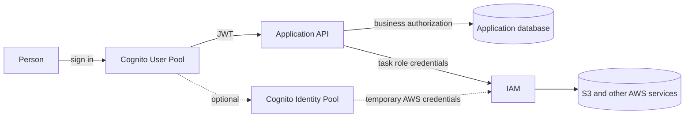

# AWS Cognito + IAM

## A practical tutorial

Learn where authentication ends, where authorization begins, and how application identities, AWS credentials, IAM policies, and business permissions fit together.

This guide follows three realistic deployments:

1. **A React application and FastAPI backend** using a Cognito User Pool, PostgreSQL, and S3.
2. **A browser accessing S3 directly** through a Cognito Identity Pool and scoped IAM role.
3. **AWS workloads and microservices** using ECS task roles to call AWS services.

It includes architecture diagrams, policy examples, a secure SaaS walkthrough, guided labs, troubleshooting steps, and a knowledge check. Code and resource names are illustrative; replace placeholders and review policies before using them.

## The short version

| Component | What it does |
| --- | --- |
| Cognito User Pool | Signs people into your application and issues tokens. |
| Cognito Identity Pool | Optionally exchanges a trusted identity for temporary AWS credentials. |
| IAM | Authenticates signed AWS requests and decides whether AWS principals can access AWS resources. |
| Your application | Decides which user can access which tenant, project, record, or business action. |

Start with [the identity and authorization boundary](foundations.md), then choose the architecture that matches who needs to call AWS services. You can also [download the original PDF](AWS_Cognito_vs_IAM_Practical_Tutorial.pdf).

## Choose a path

- **Building an API-backed SaaS?** Read [Architecture A](architecture-api.md).
- **Need the browser to call S3 directly?** Read [Architecture B](architecture-s3.md).
- **Running services on ECS?** Read [Architecture C](architecture-workloads.md).
- **Want the fundamentals first?** Start with [authentication vs authorization](foundations.md).

